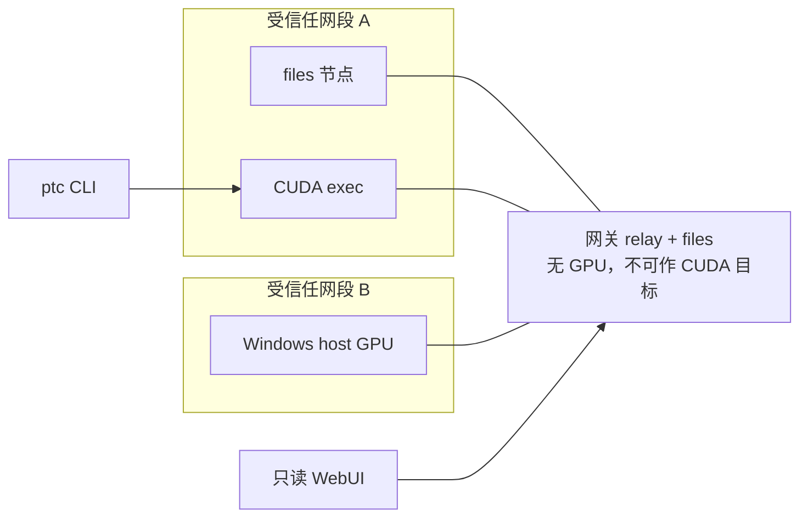

# peer-task-control (ptc)

[](https://github.com/tigeregit/peer-task-control/releases)
[](https://github.com/tigeregit/peer-task-control/blob/main/go.mod)
[](https://github.com/tigeregit/peer-task-control/actions/workflows/ci.yml)

受信任局域网上的去中心化存储与任务分发。每台机器运行同一个 daemon：按内容哈希共享种子，把 CUDA 等工作流派到合适的节点。跨网段由无 GPU 的白名单网关转发。

**API 以 CLI 为主**，并提供与二进制版本绑定的 skill 供 agent 使用；只读 WebUI 供人工查看网格。控制操作（提交、取消、改策略、清理）只在 CLI 里提供。

## 功能

- **受信任组网**：只信任配置里的 CIDR，不预置邻居名单，也不向使用者要邻居 IP。同网段用 mDNS 和端口探测；跨网段由 `relay` 网关扫描并推送目录。
- **内容寻址存储**：目录种子用 DirDigest 校验；网格内用 Bitswap 按块交换。看板上的 CID 是传输 manifest，不是 UnixFS 根。
- **任务下发**：工作流借鉴 GitHub Actions 的 job/step（首步 Prepare、末步 Package result）。`ptc submit --target` 可派到指定或 `auto` 的 exec 节点；纯做种任务用 `uses: ptc/seed@v0`。
- **只读看板**：中英双语 WebUI，任务 / 资源 / 节点分栏，与 CLI 共用本机 `/api/v1`。
- **安装与更新**：`ptc install --ssh` 做首次安装；`ptc update` 更新本机或 SSH 目标，`--mesh` 可在同主版本节点上滚动升级。

网关没有 NVIDIA GPU，也**不得**作为 CUDA 执行目标。

## 安装

预发布和正式版都从 [Releases](https://github.com/tigeregit/peer-task-control/releases) 下载对应平台的二进制，并用附件里的 `SHA256SUMS` 校验。推送 `v…` 标签会由 GitHub Actions 自动编译并发布。

```text
# 从源码构建（Go 版本以 go.mod 为准，当前为 1.26+）
go build -o ptc ./cmd/ptc
# Windows: go build -o ptc.exe ./cmd/ptc

# 在已有节点上为另一台机器做首次安装
ptc install --ssh user@host
```

在国内下载 Go 模块可以用：`go env -w GOPROXY=https://goproxy.cn,direct`。

用 Docker 部署一个真实节点或实验室网格，见 [docker/README.md](docker/README.md)。跨网段模拟测试在 `docker/test/`，不要把它当成默认部署方式。

## 快速开始

```text
# 准备配置：填写受信任 CIDR，不要写邻居 IP
copy config.example.yaml config.yaml   # Windows
# cp config.example.yaml config.yaml  # Linux / macOS

ptc daemon --config config.yaml
# 另开一个终端
ptc peers --json
ptc policy show
ptc skill print
```

先起 daemon，再等目录出现。同网段靠 mDNS 和端口探测；跨网段由 `services.relay: true` 的网关扫描受信任网段并推送目录。Agent 应使用与当前二进制一致的 `ptc skill print`（需要细节时再 `ptc skill print <topic>`），不要沿用更新前的外部 `SKILL.md`。

## 架构



- 种子身份是 **DirDigest**（内容指纹）；看板上的 **CID** 只用于 Bitswap 寻址，二者不可互换。
- 查询类命令与 WebUI 同源（`internal/query` + 本机 `/api/v1`）。

## 常用命令

完整参数、默认值、输出格式和本机 API 见 [docs/CLI.md](docs/CLI.md)。

| 命令 | 作用 |
| --- | --- |
| `ptc daemon` | 监听固定端口，加入组网 |
| `ptc peers` | 列出已知节点及执行 / 文件 / 中转服务 |
| `ptc policy` | 查看或设置本机白名单、黑名单、功能开关以及是否接受网格升级 |
| `ptc skill print [topic]` | 输出与当前版本绑定的 skill（可按主题） |
| `ptc skill list` | 列出 skill 主题 |
| `ptc version` | 打印版本 |
| `ptc install --ssh HOST` | 经 SSH 安装经过 SHA256 校验的官方 Release 二进制 |
| `ptc update [--ssh HOST\|--mesh]` | 更新本机或一个 SSH 目标，或向已记录安装的节点滚动升级 |
| `ptc submit` | 本机执行，或 `--target` 下发到网格 exec 节点（默认 follow） |
| `ptc webui` | 本机只读任务看板 |
| `ptc queue` / `ptc cancel` | 查看队列或取消作业（仅 CLI） |
| `ptc tasks` | 列出或查看网格内公开的运行记录 |
| `ptc resources` | 列出、查看、下载或 `pull` 全网种子 |
| `ptc clean` | 本机清理结果包、运行记录、种子或工作树 |
| `ptc scan` | 触发本机或指定网关的发现扫描 |

全局做种限额默认 **40GB**，自动清理目标 **20GB**，可配置 `storage.size_limit/delete_size`。详见 [全局存储规则](docs/CLI.md#全局存储规则)。

## 文档

- [命令行与本机 API](docs/CLI.md)
- [Prepare 约定](docs/PREPARE.md) / [Package result 约定](docs/PACKAGE-RESULT.md)
- [Docker 部署与测试](docker/README.md)
- [系统设计摘要](docs/DESIGN.md)
- [状态与路线图](docs/ROADMAP.md)
- [贡献与排障](docs/CONTRIBUTING.md)

工作流和种子模板在 [docs/templates/](docs/templates/)。可直接跑的示例在 `testdata/`。

协议和 daemon **不绑定 Windows**。当前用 Go 编写，已在 Windows 和 Linux 上编译并跑过单测。第一版优先服务 Windows 上的 CUDA 工作流，Linux 节点同样可以入网。操作系统服务安装属于后续工作，见 [路线图](docs/ROADMAP.md)。

## 贡献

贡献与排障请看 [docs/CONTRIBUTING.md](docs/CONTRIBUTING.md)。提交前请运行 `go test ./...`。Agent 必须使用与二进制同版本的 `ptc skill print` 输出。
