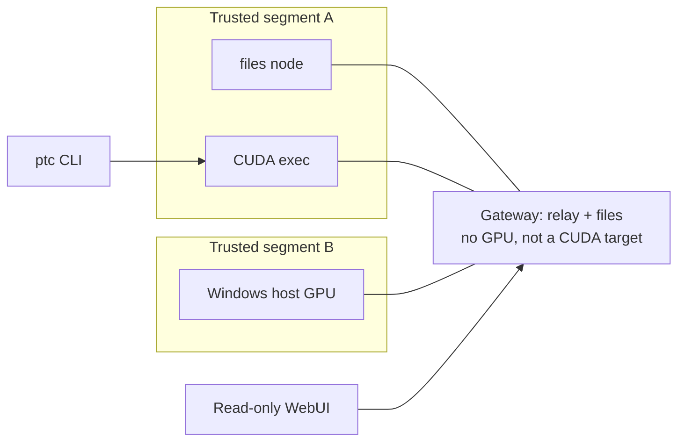

# peer-task-control (ptc)

[English](README.md) | [中文](README.zh-CN.md)

[](https://github.com/tigeregit/peer-task-control/releases)
[](https://github.com/tigeregit/peer-task-control/blob/main/go.mod)
[](https://github.com/tigeregit/peer-task-control/actions/workflows/ci.yml)

Decentralized storage and task dispatch on a trusted LAN. Every machine runs the same daemon: it shares content-addressed seeds and routes CUDA (and similar) workflows to a suitable node. Cross-segment traffic is forwarded by a GPU-less, allow-listed gateway.

**The API is the CLI.** A version-bound skill pack is provided for agents. A read-only WebUI lets humans inspect the mesh. Control operations (submit, cancel, change policy, clean) are available only on the CLI.

## Features

- **Trusted mesh**: only CIDRs listed in the config are trusted. There is no preset neighbor list, and users are never asked for neighbor IPs. On the same segment, discovery uses mDNS and port probes. Across segments, a `relay` gateway scans and pushes the catalog.
- **Content-addressed storage**: directory seeds are verified with a DirDigest. The mesh exchanges blocks with Bitswap. The CID shown on the board is a transport manifest, not a UnixFS root.
- **Job dispatch**: workflows follow GitHub Actions-style jobs and steps (Prepare first, Package result last). `ptc submit --target` dispatches to a named or `auto` exec node. Seed-only jobs use `uses: ptc/seed@v0`.
- **Read-only board**: a bilingual (Chinese / English) WebUI with Tasks, Resources, and Nodes panes, sharing the local `/api/v1` with the CLI.
- **Install and update**: `ptc install --ssh` is the first-time install. `ptc update` updates the local machine or an SSH target; `--mesh` rolls the same major version out to recorded installs.

Gateways have no NVIDIA GPU and **must not** be used as CUDA execution targets.

## Install

Download the binary for your platform from [Releases](https://github.com/tigeregit/peer-task-control/releases) (pre-releases and stable) and verify it against the attached `SHA256SUMS`. Pushing a `v…` tag makes GitHub Actions build and publish automatically.

```text
# Build from source (see go.mod for the Go version; currently 1.26+)
go build -o ptc ./cmd/ptc
# Windows: go build -o ptc.exe ./cmd/ptc

# First-time install onto another machine from a node that already has ptc
ptc install --ssh user@host
```

In mainland China you can download Go modules with: `go env -w GOPROXY=https://goproxy.cn,direct`.

To deploy a real node or a lab mesh with Docker, see [docker/README.md](docker/README.md). Cross-segment simulation tests live in `docker/test/`; do not treat that stack as the default deployment.

## Quick start

```text
# Prepare a config: fill in trusted CIDRs, and do not list neighbor IPs
copy config.example.yaml config.yaml   # Windows
# cp config.example.yaml config.yaml  # Linux / macOS

ptc daemon --config config.yaml
# In another terminal
ptc peers --json
ptc policy show
ptc skill print
```

Start the daemon first, then wait for the catalog to appear. Same-segment discovery uses mDNS and port probes. Across segments, a gateway with `services.relay: true` scans the trusted CIDRs and pushes the catalog. Agents should use `ptc skill print` from the current binary (and `ptc skill print <topic>` when they need detail), not a leftover `SKILL.md` from a previous update.

## Architecture



- A seed's identity is its **DirDigest** (content fingerprint). The **CID** on the board is only for Bitswap addressing. The two are not interchangeable.
- Query commands and the WebUI share the same source (`internal/query` + the local `/api/v1`).

## Common commands

Full flags, defaults, output formats, and the local API are in [docs/CLI.md](docs/CLI.md).

| Command | Purpose |
| --- | --- |
| `ptc daemon` | Listen on the fixed port and join the mesh |
| `ptc peers` | List known nodes and their exec / files / relay services |
| `ptc policy` | Show or set the local allow list, deny list, feature switches, and whether mesh updates are accepted |
| `ptc skill print [topic]` | Print the skill pack bound to this binary (optionally one topic) |
| `ptc skill list` | List skill topics |
| `ptc version` | Print the version |
| `ptc install --ssh HOST` | Install a SHA256-verified official Release binary over SSH |
| `ptc update [--ssh HOST\|--mesh]` | Update the local machine or one SSH target, or roll an update to recorded installs |
| `ptc submit` | Run locally, or dispatch with `--target` to a mesh exec node (follow is the default) |
| `ptc webui` | Local read-only task board |
| `ptc queue` / `ptc cancel` | Inspect the queue or cancel a job (CLI only) |
| `ptc tasks` | List or inspect run records published on the mesh |
| `ptc resources` | List, inspect, download, or `pull` seeds from the mesh |
| `ptc clean` | Clean local result packages, run records, seeds, or worktrees |
| `ptc scan` | Trigger a discovery scan on the local node or a named gateway |

The global seeding quota defaults to **40GB**, with an automatic cleanup target of **20GB**. Configure `storage.size_limit/delete_size`. See [Global storage rules](docs/CLI.md#global-storage-rules).

## Documentation

- [CLI and local API](docs/CLI.md)
- [Prepare convention](docs/PREPARE.md) / [Package result convention](docs/PACKAGE-RESULT.md)
- [Docker deploy and tests](docker/README.md)
- [System design summary](docs/DESIGN.md)
- [Status and roadmap](docs/ROADMAP.md)
- [Contributing and troubleshooting](docs/CONTRIBUTING.md)

Workflow and seed templates are in [docs/templates/](docs/templates/). Runnable examples are in `testdata/`.

The protocol and daemon are **not Windows-only**. The project is written in Go, and it has been built and unit-tested on Windows and Linux. The first release prioritizes CUDA workflows on Windows; Linux nodes can join the mesh the same way. Installing as an OS service is later work; see the [roadmap](docs/ROADMAP.md).

## Contributing

See [docs/CONTRIBUTING.md](docs/CONTRIBUTING.md) for contributing and troubleshooting. Run `go test ./...` before you send a change. Agents must use the `ptc skill print` output that is bound to the same binary version.
